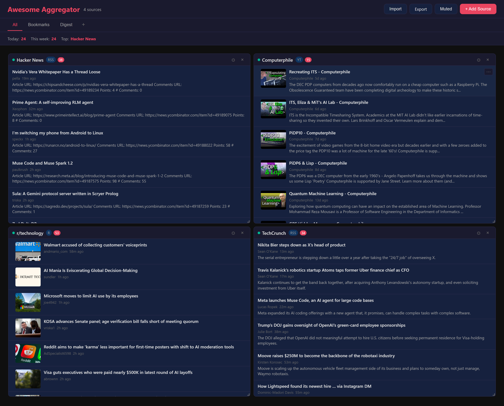
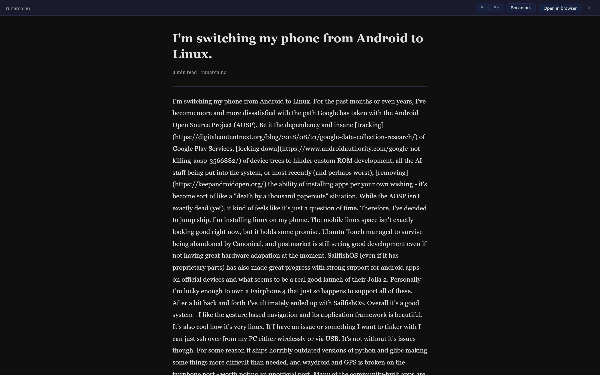
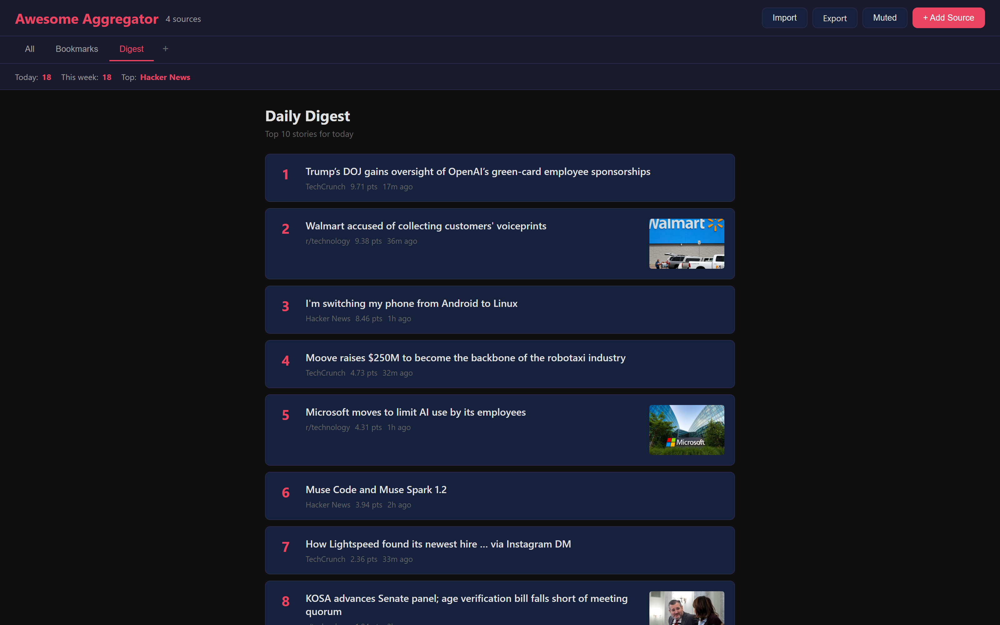
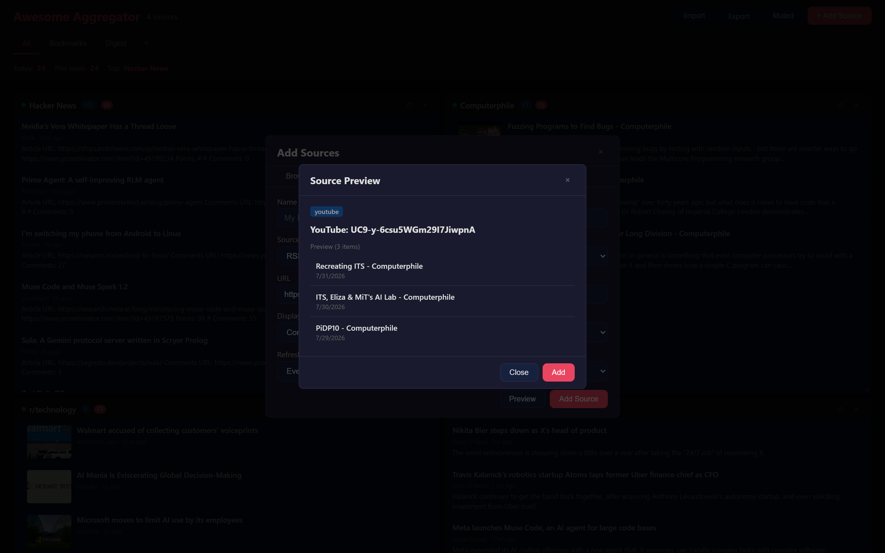

# Awesome Aggregator

[](https://github.com/scaso01/awesome-aggregator/actions/workflows/ci.yml)
[](LICENSE)
[](https://www.python.org/)

A self-hosted content dashboard that replaces a wall of open browser tabs. Point it at the feeds you already follow, arrange them in a grid that looks the way you want, and let new items arrive on their own.



## Why

Feed readers give you one long list. Start pages give you links, not content. This gives you a board: every source is a panel you can move, resize and format independently, and the panels fill themselves while you read.

Everything runs on your own machine. There is no account, no cloud service, and no API key required for any of the built-in source types.

## Features

- **Four source types.** RSS and Atom feeds, YouTube channels, Reddit subreddits, and any web page that trafilatura can read.
- **A grid you arrange.** Drag panels around, resize them, and the layout is saved.
- **Six display formats per panel.** Compact, magazine, headlines, cards, gallery, or text only, chosen per source.
- **Live updates.** A background scheduler refreshes each source on its own interval and pushes new items over a WebSocket.
- **Named views.** Group sources into workspaces like "Morning Briefing", with keyword include and exclude filters, as tabs you can reorder.
- **Reader mode.** A full screen, serif, distraction free view of the article text with adjustable type size.
- **Paste a URL, get a source.** Auto-detects the type and previews sample items before you subscribe.
- **Bookmarks, hiding and muting.** A three dot menu on every item: save it for later, hide what you have already seen, or mute a noisy source for a day, a week, a month, or for good. Muted sources come back from the Muted button in the header.
- **Daily digest.** The day's ten strongest items, ranked by engagement and recency, with a penalty so one chatty source cannot take over.
- **Headline cleanup.** Strips shouting capitals, pile-ups of punctuation, clickbait prefixes and trailing site names.
- **OPML in and out.** Bring your feeds from another reader, or hand your collection to someone else.
- **Reading stats.** What you read today and this week, and which sources you actually go back to.

## Screenshots

| Reader mode | Daily digest |
|---|---|
|  |  |

Paste any URL and the type is detected for you, with a preview before you commit:



## Quick start

Requires Python 3.12 or newer and Node.js 20 or newer.

```bash
git clone https://github.com/scaso01/awesome-aggregator.git
cd awesome-aggregator

pip install -r requirements.txt

# Build the frontend once, and the backend will serve it
cd frontend && npm install && npm run build && cd ..

python -m backend.app
```

Open <http://localhost:8001>. Three sources are loaded on first run so the board is not empty.

### Working on the frontend

For hot reload, run the two halves separately. The Vite dev server proxies the API and the WebSocket to the backend, so the backend has to be on port 8001.

```bash
# Terminal 1
python -m backend.app

# Terminal 2
cd frontend && npm run dev
```

Open <http://localhost:5173>.

## Configuration

`config.yaml` holds everything you are likely to change: the port, refresh intervals per source type, cache size and TTL, grid defaults, and the sources loaded on first run.

```yaml
server:
  port: 8001

scheduler:
  default_interval_seconds: 300
  intervals:
    rss: 300
    youtube: 600
    reddit: 600
```

`HOST` and `PORT` environment variables override the server block. Copy `.env.example` to `.env` if you want to set them there. No source type needs a key, so `.env` is optional.

## How each source type fetches

| Type | Method | Notes |
|---|---|---|
| RSS | feedparser over the feed URL | Atom works too |
| YouTube | the channel's RSS feed | No Data API key needed |
| Reddit | the subreddit's public Atom feed | Rate limited, see below |
| Generic | trafilatura article extraction | For pages with no feed |

**A note on Reddit.** Reddit blocks its `.json` endpoints for clients that are not signed in, so this reads the public Atom feed instead. That feed works without an account but is rate limited per IP, and the limit is tight enough that back to back requests get a 429. The default refresh interval for Reddit is ten minutes for that reason. If you run through a VPN or a hosting provider, expect Reddit to throttle you harder than it would a home connection, and a subreddit panel may sit empty with the error shown in the panel. Every other source type is unaffected.

Because the Atom feed carries no vote or comment counts, Reddit items show no score, and the digest ranks them on recency alone.

### Optional: many more platforms through RSSHub

`docker-compose.yml` starts [RSSHub](https://docs.rsshub.app/), which turns a long list of sites that publish no feed into ones that do. Start it with `docker compose up -d`, then add the RSSHub route as an ordinary RSS source.

## Architecture

```
Content sources (RSS, YouTube, Reddit, web pages)
        |  APScheduler fetches each on its own interval
FastAPI backend
        |  writes to SQLite, pushes over a WebSocket
React frontend
        |  renders a react-grid-layout board
Your dashboard
```

Every source type is an adapter behind one small interface, so adding a fifth is a single new file:

```python
class BaseSource(ABC):
    @abstractmethod
    async def fetch(self) -> list[ContentItem]: ...

    @abstractmethod
    def get_display_name(self) -> str: ...

    @abstractmethod
    def get_source_type(self) -> str: ...
```

Deeper notes live in [docs/ARCHITECTURE.md](docs/ARCHITECTURE.md). The research behind the stack choices is in [docs/FRONTEND_RESEARCH.md](docs/FRONTEND_RESEARCH.md), [docs/EXISTING_PROJECTS.md](docs/EXISTING_PROJECTS.md) and [docs/PLATFORM_INTEGRATION.md](docs/PLATFORM_INTEGRATION.md).

## API

Interactive docs are at <http://localhost:8001/docs> while the app is running.

| Router | Prefix | Purpose |
|---|---|---|
| Sources | `/api/sources` | Create, read, update, delete, and batch create |
| Content | `/api/content` | Items per source, or filtered through a view |
| Views | `/api/views` | Named view CRUD, reorder, keyword filters |
| Layouts | `/api/layouts` | Save and load the grid |
| Bookmarks | `/api/bookmarks` | Save items for later |
| Actions | `/api/actions` | Hide items, mute and unmute sources |
| Reader | `/api/reader` | Article extraction |
| Detect | `/api/detect` | URL type detection and preview |
| Discover | `/api/discover` | Suggested sources by topic |
| OPML | `/api/opml` | Import and export |
| Digest | `/api/digest` | The day's top items |
| Stats | `/api/stats` | Reading events and summary |

Real time updates arrive on `/ws`, and `/api/health` reports status and the connected client count.

## Development

```bash
pip install -r requirements-dev.txt
python -m playwright install chromium   # for the browser tests

# Build the frontend, so the browser tests have a page to drive
cd frontend && npm install && npm run build && cd ..

# Start the service. Anything that talks to it skips itself when
# nothing is listening on port 8001, so this comes first.
python -m backend.app &

python -m pytest tests/
```

`python -m pytest tests/ -m "not browser"` skips the Chromium tests if you have not installed a browser.

### How the suite is put together

Most of the defects in the first public release were things no ordinary test could see: the backend was healthy, its tests passed, the frontend compiled, and features still did nothing. Each layer below exists for a class of failure that got through.

| Layer | Catches |
|---|---|
| Unit and adapter tests | Parsing, scoring, cleanup, database behaviour |
| `test_reddit_source.py` | Feed parsing, against a real captured subreddit feed |
| `test_frontend_api_contract.py` | A `fetch` aimed at a route or method the backend does not serve |
| `test_frontend_wiring.py` | A component that is imported by nothing, or never rendered |
| `test_dashboard.py`, `test_ui_actions.py` | Live HTTP, with the exact payloads the interface sends, and a WebSocket that carries traffic rather than only completing a handshake |
| `test_scheduler_recovery.py` | A source that fails once being able to come back |
| `test_browser.py` | The real page in Chromium: clicking, dragging, reloading, every display format, and a pushed item arriving with no reload |

Tests that need a live service skip themselves when there is not one. That is convenient locally and dangerous in CI, so `tests/audit_skips.py` splits skips into infrastructure and data. An infrastructure skip fails the build, because it means coverage quietly vanished. A data-dependent skip is allowed, capped and printed.

CI runs the suite on Python 3.12, 3.13 and 3.14 against fixture feeds served from localhost, so a red badge means this project broke rather than a news site being slow. `AGGREGATOR_CONFIG` is what points the app at those fixtures, and you can use it to run a second instance from one checkout.

## Troubleshooting

**A panel shows an error instead of items.** The message in the panel is the fetch error verbatim. A 403 or 429 from Reddit is rate limiting, see the note above. For an RSS source, check the URL really serves a feed and not an HTML page. A source in error keeps its normal schedule and clears itself on the next fetch that works, so a site being down for an hour fixes itself. Pausing a source is the only thing that stops it being refreshed.

**The page loads but nothing updates.** The live push needs `/ws`. Open the browser console and look for a WebSocket failure. If you are behind a reverse proxy, it has to be configured to forward upgrade requests.

**The frontend loads but every API call fails in dev mode.** Vite proxies `/api` and `/ws` to port 8001. Run the backend there, or change the target in `frontend/vite.config.js`.

**Port 8001 is already in use.** Set `PORT` in the environment or change `server.port` in `config.yaml`, and update the proxy target in `frontend/vite.config.js` to match.

**Starting over.** Delete `aggregator.db` and restart. It is recreated on the next launch.

## Project layout

```
awesome-aggregator/
├── backend/
│   ├── app.py           FastAPI entry point, routers, WebSocket, static mount
│   ├── config.py        config.yaml plus .env
│   ├── models.py        Pydantic models
│   ├── database.py      SQLite via aiosqlite, auto-migrating
│   ├── scheduler.py     APScheduler background refresh
│   ├── websocket.py     Connection manager for the live push
│   ├── api/             One module per router
│   ├── sources/         rss, youtube, reddit, generic, behind base.py
│   └── utils/           Headline cleanup
├── frontend/
│   └── src/
│       ├── App.jsx      Root component
│       ├── components/  Panels, tab bar, reader, digest, modals
│       └── styles/      One stylesheet
├── tests/
├── docs/
├── config.yaml
└── requirements.txt
```

Content lives in SQLite across eight tables: `sources`, `content_items`, `layouts`, `views`, `bookmarks`, `hidden_items`, `muted_sources` and `reading_events`. The database is created on first run and migrates itself on startup.

## License

MIT. See [LICENSE](LICENSE).
